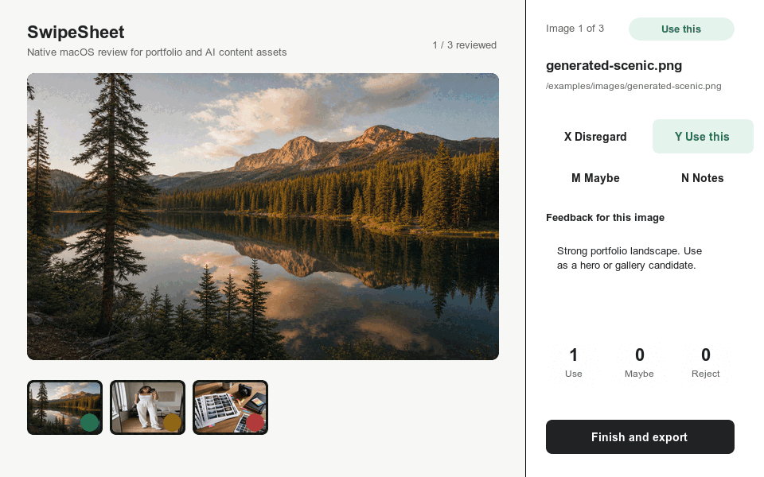

# SwipeSheet

[](https://github.com/uneasymusings/swipesheet/actions/workflows/ci.yml)

Contact sheets, but swipeable. Open a local folder or manifest, quickly approve/reject/annotate images in a native macOS window, then copy a clean export back into your AI CLI.


## Why

Contact sheets are great for seeing everything at once, but they are painful when the next step is giving precise feedback to an AI agent. SwipeSheet turns that review pass into a focused desktop workflow:

- `x`: reject
- `y` or `Enter`: use this
- `m`: maybe / needs notes
- `n`: write feedback
- left/right arrows: navigate

At the end, **Finish and export** gives you copy-ready text with selected images, maybe items, rejection notes, and full original file paths.



## Built For

- Portfolio curation: review film scans, contact-sheet selects, or generated image folders and hand exact original paths back to a site-building agent.
- AI content review: approve persona candidates, feed images, thumbnails, and generated frames before they move into another pipeline step.
- Agent workflows: paste one structured export into Codex, Claude Code, or another CLI agent instead of manually describing image numbers.

## Features

- Native macOS AppKit review window.
- Zero runtime npm dependencies.
- Local-first: no uploads, no accounts, no database, no telemetry.
- Recursive folder scanning and manifest-based review.
- Plain JSON session files you can resume or inspect.
- Copy-ready AI-agent export plus JSON export for scripts.
- Grouped review sessions with constraints, group decisions, reorderable storyboards, and finish-time validation.
- Works as a reusable CLI from any project directory.

## Quick Start

Requirements:

- macOS
- Node.js 18.18 or newer
- Xcode Command Line Tools / Swift compiler

Run the included sample:

```bash
npm test
npm run build:native
npm start
```

Install the `swipesheet` command for use from any repo:

```bash
npm link
```

Review a real folder:

```bash
swipesheet review ~/Desktop/PHOTO --title "Portfolio scenic selects"
```

Review a manifest:

```bash
swipesheet review ./examples/sample-manifest.json \
  --title "Example review" \
  --prompt "Pick strong images and note any conditions before use."
```

## CLI

```bash
swipesheet review <image-or-folder-or-manifest...> [options]
swipesheet resume <session-json> [options]
swipesheet export <session-json> [--format agent|json|autogen]
swipesheet autogen manifest personas <folder> --out <manifest-json>
swipesheet autogen manifest content-sets <pipeline-memory-json> --out <manifest-json>
swipesheet build-native
```

Review options:

```text
--title <text>          Human-readable review title
--prompt <text>         Review intent copied into the final export
--session <name>        Short name used in the session filename
--batch-size <number>   Number of images shown in the queue strip, default 20
--limit <number>        Review only the first N discovered images
```

During local development, run the package command directly:

```bash
npm start
```

After `npm link`, run it from any project directory:

```bash
swipesheet review ./out/images \
  --title "Approval pass"
```

## Using From Other AI CLI Sessions

In the project where another AI CLI is generating or editing images, tell that agent to run SwipeSheet from that project's directory:

```text
Run: swipesheet review <image-folder-or-manifest> \
  --title "<short review name>" \
  --prompt "<what I should decide while reviewing>"

After I finish the native review window, use the exported selected paths and notes to continue the task.
```

The review session is saved in that project's `.swipesheet/sessions/` directory. The agent can export it later with:

```bash
swipesheet export .swipesheet/sessions/<session>.json
```

If the agent needs a machine-readable result:

```bash
swipesheet export .swipesheet/sessions/<session>.json --format json
```

For aut0gen review state, export the stable grouped contract:

```bash
swipesheet export .swipesheet/sessions/latest.json --format autogen
```

Aut0gen-oriented helper commands can create grouped manifests:

```bash
swipesheet autogen manifest personas ./references/personas --out .autogen/reviews/personas.json
swipesheet autogen manifest content-sets .autogen/pipeline-memory.json --out .autogen/reviews/content-sets.json
```

## Inputs

SwipeSheet accepts:

- directories of images, scanned recursively
- direct image paths
- JSON manifests
- text, CSV, or TSV files containing image paths

Supported extensions:

```text
jpg jpeg png gif webp bmp svg avif heic heif tif tiff dng cr2 nef arw raf rw2
```

The native viewer asks macOS to load each image with `NSImage`, so common photo formats such as JPG, PNG, TIFF, HEIC, and GIF are handled directly. If macOS cannot display a file, the app still keeps the original path and shows a placeholder.

## Manifest Format

The simplest manifest is an array of paths:

```json
[
  "/absolute/path/to/image-01.jpg",
  "/absolute/path/to/image-02.jpg"
]
```

For richer workflows:

```json
{
  "images": [
    {
      "path": "out/mari/candidate-01.png",
      "label": "Mari",
      "note": "Generated identity candidate",
      "score": 8
    }
  ]
}
```

Relative paths resolve from the manifest file's directory. Extra fields are preserved in `metadata` and included in JSON exports.

Grouped review manifests let another system keep IDs, constraints, and ordered content-set state intact:

```json
{
  "kind": "autogen_review",
  "reviewType": "storyboard",
  "itemActions": ["use", "replace", "reject"],
  "groupActions": ["approve_sequence", "needs_reorder", "request_changes"],
  "groups": [
    {
      "id": "cs_123",
      "label": "EDC verdict slideshow",
      "metadata": {
        "contentSetId": "cs_123",
        "briefId": "brief_abc",
        "platform": "tiktok",
        "itemActionLabels": {
          "use": "Use slide",
          "replace": "Replace slide"
        },
        "groupActionLabels": {
          "approve_sequence": "Approve sequence"
        },
        "noteRequiredStatuses": ["request_changes"],
        "description": "What this group contains and why it exists.",
        "objective": "What I should decide during review.",
        "selectionCriteria": [
          "The quality bar or acceptance criteria for this review"
        ],
        "reviewInstructions": [
          "Specific instructions the presenting agent wants followed"
        ],
        "caption": "...",
        "cta": "..."
      },
      "constraints": {
        "minSelected": 3,
        "maxSelected": 10,
        "requiresOrder": true,
        "requiredAspect": "9:16"
      },
      "items": [
        {
          "id": "slide_1",
          "path": "out/slides/slide-01.png",
          "label": "Hook slide",
          "metadata": {
            "slideIndex": 1,
            "role": "hook",
            "description": "What this specific asset is supposed to do."
          }
        }
      ]
    }
  ]
}
```

The native UI turns these fields into a review brief: what you are reviewing, how to decide, objective, criteria, instructions, checklist, content context, persona context, publish readiness, warnings, and current asset description. Grouped reviews also get a group rail and a storyboard strip where the visual order is saved as `groupDecisions[groupId].itemOrder` and included in JSON/aut0gen exports.

`metadata.itemActionLabels` and `metadata.groupActionLabels` change button text without changing raw statuses on disk. Legacy `metadata.actionLabels` is still read as a group-label fallback. `metadata.noteRequiredStatuses` is group-scoped and makes finish-time validation require group notes for statuses such as `request_changes` or `needs_reorder`.

## Sessions

Sessions are saved under the project where you run the command:

```text
.swipesheet/
  sessions/
    latest.json
    20260625T190000Z-review.json
  bin/
    swipesheet-macos
```

That makes it practical for other repos to invoke the tool. A portfolio repo can keep its own review history, while an AI content pipeline can keep approval sessions next to generated outputs.

`latest.json` is treated as a pointer. `swipesheet resume .swipesheet/sessions/latest.json` resolves to the timestamped session before opening the native app, and regular-file fallback copies prefer the newest timestamped session.

For grouped sessions, `finishedAt` is only written after validation passes or unresolved groups are explicitly marked `skipped`.

## Export Example

The agent-oriented export looks like this:

```text
# Image review export: Portfolio film selects

Reviewed: 42/42
Use: 18
Maybe / needs notes: 4
Reject: 20

Selected images:
- #0001 | Roll 12 | frame-001.tif
   path: /Users/you/Desktop/PHOTO/Roll 12/frame-001.tif
   note: Use for homepage hero, crop tighter on the left.
```

Export later from the terminal:

```bash
swipesheet export .swipesheet/sessions/<session>.json
swipesheet export .swipesheet/sessions/<session>.json --format json
```

## Development

```bash
npm test
npm run build:native
npm run assets:demo
```

`npm run assets:demo` requires ImageMagick's `magick` binary and regenerates the README demo GIF from the generated sample images.

## Documentation

- [Architecture](docs/ARCHITECTURE.md)
- [Workflow Guide](docs/WORKFLOWS.md)
- [Generated Assets](docs/ASSETS.md)
- [Roadmap](docs/ROADMAP.md)

## License

MIT
